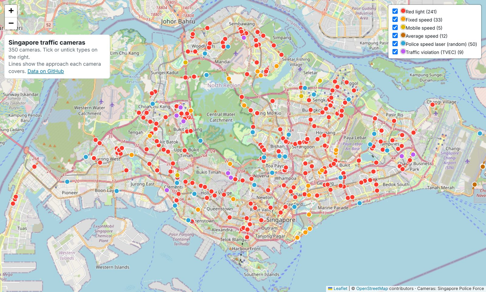

# Singapore Traffic Enforcement Cameras

    

This repo contains locations of all 350 traffic enforcement cameras published by the Singapore Police Force (SPF). It also contains manually reviewed approach paths and bearings for each camera.

The data is meant for GPS camera-warning devices. 

Data is updated monthly. A GitHub Actions workflow checks the SPF pages once a month and updates the data when cameras are added, moved or removed, and is published after a manual review.

## Map

[Open the interactive map](https://quekdylan.github.io/sg-traffic-cameras/map/) to zoom in, see each camera's approach path, and filter by type.

## Camera types

| Code | Type | Count |
|---|---|---|
| 1 | Red light camera | 241 |
| 2 | Fixed speed camera | 33 |
| 3 | Mobile speed camera | 5 |
| 4 | Average speed camera (Tanah Merah Coast Road) | 12 |
| 5 | Police speed laser camera | 50 |
| 6 | Traffic violation enforcement camera (TVEC) | 9 |

## Files

| File | What it is |
|---|---|
| `data/cameras.csv` | One row per camera, for spreadsheets and scripts |
| `data/cameras.json` | Same data as JSON |
| `data/camera_data.h` | C/C++ header for microcontrollers (ESP32 etc.), about 12 KB of flash |
| `manifest.json` | Data version, counts and SHA-256 of each file, for devices that check for updates |
| `review/` | Cameras waiting for their paths to be checked, and the result of the last SPF check |
| `tools/`, `editor/`, `map/` | The update scripts, the path editor and the map page |

## Fields

| Field | Meaning |
|---|---|
| `id` | Camera id, stable across updates |
| `type` | Camera type code (see below) |
| `category` | Camera type name |
| `location` | SPF's own description, e.g. `Adam Rd by Dunearn Rd twds Farrer Rd` |
| `lat`, `lon` | Camera position as published by SPF (WGS84) |
| `bearing_deg` | (CSV only) Direction of travel at the camera, 0 = north, 90 = east |
| `path_length_m` | (CSV only) Length of the approach path in metres |
| `path_points` | (CSV only) Number of points in the path |
| `path` | The approach path. Points run from the start of the approach to the camera, so the last point is at the camera. In the CSV the points are `lat lon` pairs separated by `;`. In the JSON they're `[lat, lon]` arrays. |

In `camera_data.h`, coordinates are integers in micro-degrees (degrees × 1,000,000). `kCameras[i].firstPoint` and `pointCount` index into `kCameraPoints`.

## Using it on a device

A simple approach that works well:

1. Shortlist cameras within about 600 m of the GPS fix.
2. For each one, find the closest segment of its path. It's a match if you're within about 20m of it sideways and your heading is within about 35° of the segment's direction.
3. Distance to the camera = the distance along the path from your projected position to the last point.
4. Warn when the distance is under `max(150 m, speed × 12 s)` and two fixes in a row match. Clear the warning once you pass the end of the path.

To keep a device up to date, download `manifest.json` from this repo, compare its `version` with the one stored on the device, and if it's newer, download the data files and check them against the SHA-256 values listed.

## Suggesting a fix

Notice an issue with the data?

- **Fix a path yourself:** open the [path editor](https://quekdylan.github.io/sg-traffic-cameras/editor/), go to **Fix a camera** and find it by number or road name (or tap **Suggest a fix** on the [map](https://quekdylan.github.io/sg-traffic-cameras/map/)). Correct the path, then press **Review and submit** and **Submit on GitHub**. GitHub opens with your fix filled in: choose **Propose changes**, then **Create pull request**. It goes live once it's merged upon manual review.
- **Or just report it:** [open an issue](https://github.com/quekdylan/sg-traffic-cameras/issues/new) with the camera number and what's wrong.

## Sources

- SPF, [Red Light Camera Locations](https://www.police.gov.sg/knowledge-hub/traffic/traffic-matters/red-light-camera-locations)
- SPF, [Speed Enforcement Camera Locations](https://www.police.gov.sg/Knowledge-Hub/Traffic/Traffic-Matters/Speed-Enforcement-Camera-Locations)
- SPF, [Traffic Violation Enforcement Camera Locations](https://www.police.gov.sg/knowledge-hub/traffic/traffic-matters/traffic-violation-enforcement-camera-locations)
- Road geometry © [OpenStreetMap contributors](https://www.openstreetmap.org/copyright)

## License

The approach paths are derived from OpenStreetMap, so this dataset is released under the [Open Database License (ODbL) 1.0](https://opendatacommons.org/licenses/odbl/1-0/). You're free to use, share and adapt it, including commercially, as long as you:

- credit "© OpenStreetMap contributors" and the Singapore Police Force as the source of the camera locations, and
- share any database you build from it under the ODbL as well.

This project isn't affiliated with or endorsed by the Singapore Police Force. The data is provided as-is, with no guarantee that it's complete or accurate. Always obey road signs and speed limits.
